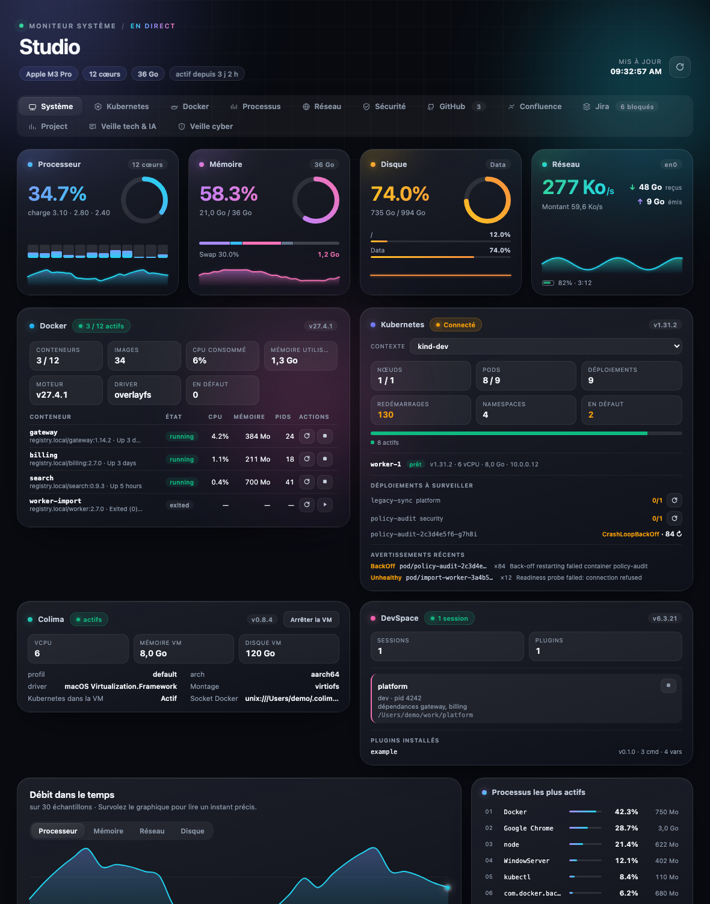
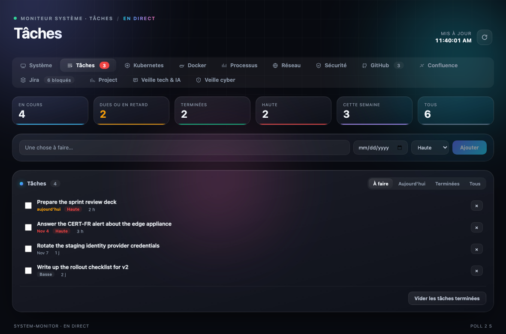
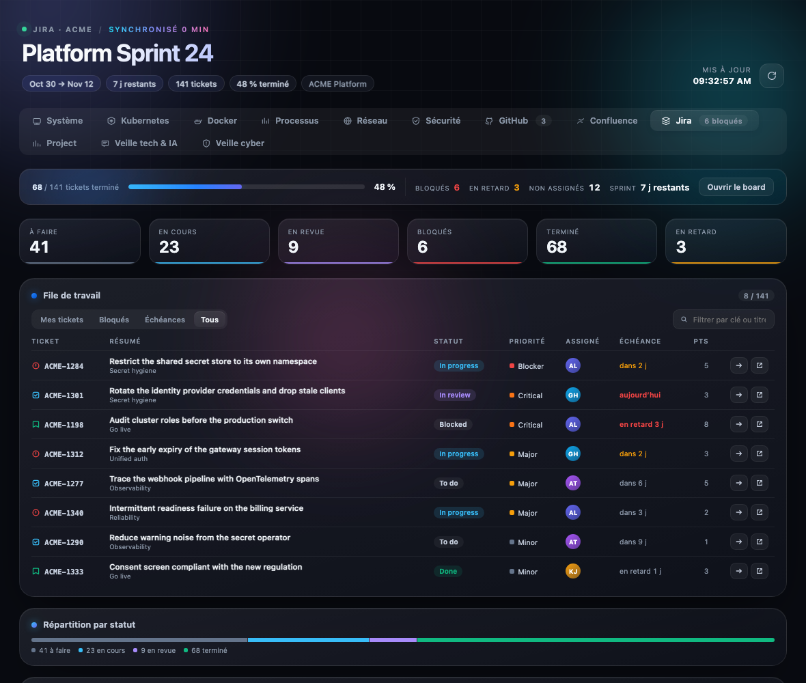

# dsh-system-monitor

A thirteen-tab workspace for the DSH Web GUI: what the machine is doing, what the
container stack is doing, what your team is doing, and what the world shipped
today — in one panel, with a control for almost everything it shows.



## The tabs

| Tab | What it answers | Controls |
|---|---|---|
| **Système** | CPU, memory, disk, network, and the container stack at a glance | refresh |
| **Tâches** | A local to-do list: add, complete, delete, due dates, priorities, filters | every change |
| **Kubernetes** | Context, nodes, pod phases, restarts, deployments, per-namespace resource requests, warning events | switch context, restart a rollout, delete a pod |
| **Docker** | Containers with CPU/memory/PIDs, images, volumes, networks, compose projects | start, stop, restart, read the logs |
| **Processus** | The 40 busiest processes, by CPU or memory, with PID, RSS and elapsed time | stop a process |
| **Réseau** | Listening TCP ports with the owning process and bind address, exposed-port filter, interfaces, rates | exposed-only filter |
| **Sécurité** | FileVault, firewall, SIP, Gatekeeper, last update, machine identity | — |
| **GitHub** | Review requests, open pull requests, assigned issues, unread notifications | open on GitHub |
| **Confluence** | Recent pages, my contributions, spaces | open a page |
| **Jira** | Sprint line, status tiles, a filterable work queue, breakdowns, the tickets that need attention | transition a ticket |
| **Projet** | Project KPIs: open, created/resolved over 7 and 30 days, net flow, overdue, unassigned, load by assignee, by epic, by status, by priority | — |
| **Veille tech & IA** | 40 articles from Hacker News, dev.to, Hugging Face and TechCrunch, as cards with pictures | filter by source, open an article |
| **Veille cyber** | CERT-FR alerts and advisories, GitHub security advisories with CVE/severity/CVSS, attack headlines | open the source |

Clicking a Jira row opens the issue drawer: fields, description, subtask
progress, the latest comments and the transitions Jira currently offers.
Clicking a container's log button opens the last 200 lines Docker kept.





## Requirements

Nothing here is mandatory — each tab degrades to "not installed" on its own.

| Tool | Enables | Notes |
|---|---|---|
| DSH | everything | the plugin runs inside a DSH profile |
| `docker` | Docker tab, Colima card | a running daemon |
| `kubectl` | Kubernetes tab | a current context |
| `colima` | Colima card | macOS VM runtime |
| `devspace` | DevSpace card | detects live `devspace dev` sessions |
| `gh` | GitHub tab | must already be signed in (`gh auth login`) |
| A Jira API token | Jira and Projet tabs | see below |
| The same token | Confluence tab | one Atlassian site serves both |

**Platforms.** macOS is fully supported. Linux covers the machine, container and
process tabs through `/proc` and `free`. Windows runs the plugin but the machine
tab stays minimal; the security tab is macOS-only and says so.

## Install

The Plugins page accepts a package name, a Git URL, a tarball or an absolute
local path.

**From a checkout or a clone**

Plugins → the arrow beside **Add plugin** → **Install a third-party plugin** →
paste the absolute path of this directory → **Install** → **Enable now**.

**From a tarball**

```bash
npm pack                        # produces dsh-system-monitor-1.0.0.tgz
# or: pnpm pack
```

Then install that `.tgz` the same way, by its absolute path.

**From a registry**

```bash
npm publish                     # then install by name: dsh-system-monitor
```

Before publishing under your own account, change `name`, `author` and `version`
in `package.json`; keep `cordis.patch.yml` in sync with `name`, since that is
what the Loader resolves.

After installing, a **Système** entry appears in the panel list at the top of the
left sidebar. Restart the application when the dialog says so: the Host loads
its modules once at boot.

## Configuration

Every field is optional. They go in the plugin row of your profile's
`cordis.patch.yml`:

```yaml
- id: system-monitor
  name: dsh-system-monitor
  config:
    fastMs: 2000          # CPU, memory, disk, network (1000–60000)
    slowMs: 15000         # docker, colima, kubernetes, devspace (5000–600000)
    jiraMs: 60000         # Jira
    workspaceMs: 120000   # GitHub, Confluence, security, ports
    newsMs: 600000        # watch feeds (120000–3600000)
    historySize: 180      # chart samples (180 ≈ 6 min at 2 s)
    extraPaths: []        # extra directories to search for the CLIs
    jira:
      baseUrl: https://your-site.atlassian.net
      email: you@company.com
      project: ABC          # pinned project key
      projects: [ABC, OPS]  # preferred keys when none is pinned
      boardId: 42           # reads the active sprint through the Agile API
      jql: 'project = ABC AND resolution = Unresolved'
      authType: basic       # 'basic' for Cloud, 'bearer' for a Data Center PAT
      maxIssues: 120
      tokenFile: ~/.dsh/jira.env
```

### Jira credentials

The token never lives in the plugin config. By default the reader looks for it
in `$DSH_HOME/jira.env` (falling back to `~/.dsh/jira.env`):

```bash
# ~/.dsh/jira.env — keep it at 0600
JIRA_URL=https://your-site.atlassian.net
JIRA_EMAIL=you@company.com
JIRA_API_TOKEN=…
```

Create a token at <https://id.atlassian.com/manage-profile/security/api-tokens>.
The reader tries every source it can find — the row config, the file, then
`JIRA_API_TOKEN` and `JIRA_TOKEN` from the environment — and reports which one
worked. A stale environment variable therefore cannot shadow a valid file.

Without a token the two Atlassian tabs show a setup card naming exactly which
variables are missing, instead of an empty board.

## Your to-do list

The **Tâches** tab is the only tab that owns data instead of reading it. The list
is a plain JSON file on the Host, written atomically (temp file + rename) after
every change, so a crash cannot truncate it:

```
$DSH_HOME/data/system-monitor/todos.json      # 0600, ~/.dsh/... without DSH_HOME
```

Override the location with `todosFile` in the row config. Each entry holds its
text, a done flag, a due date and a priority; the list is capped at 500 items and
500 characters per item, and every mutation is validated on the Host before it
reaches disk. Nothing about it leaves the machine, and editing the file by hand
is supported — the panel refetches when the file's timestamp changes.

## Controls

Twelve actions exist on the system and Jira side, and only those:

| Action | Target |
|---|---|
| `docker.start` · `docker.stop` · `docker.restart` · `docker.remove` | a container reported by the last snapshot |
| `colima.start` · `colima.stop` | a Colima profile reported by the last snapshot |
| `kube.context` | a context from `kubectl config get-contexts` |
| `kube.restart` | a deployment `namespace/name` from the last snapshot |
| `kube.deletePod` | a pod `namespace/name` from the last snapshot |
| `process.kill` | a pid from the last process list |
| `jira.transition` | a transition id Jira itself just offered for that issue |

Every target is re-validated against the last completed snapshot before a
command is built, so no string from the browser ever reaches a command line, and
nothing runs through a shell. Destructive buttons arm on the first click and run
on the second, within four seconds.

## Security and privacy

- **Every HTTP route is gated** by the composition's
  `connection.requestRejection` — the Host/Origin fence plus browser
  authentication. Unauthenticated callers get nothing.
- **Read-only by default.** The plugin never writes to your system, and the
  twelve controls above are the entire write surface.
- **The image proxy is deliberately narrow.** It only fetches `http(s)` URLs,
  refuses credentials in the URL, resolves the hostname and rejects loopback,
  link-local and RFC 1918 addresses, requires an `image/*` content type, caps
  the body at 3 MiB, and caches in memory for 15 minutes.
- **What leaves the machine:** your Atlassian site (Jira and Confluence, with
  your token), `api.github.com` through `gh`, and six public feeds — Hacker
  News, dev.to, Hugging Face, TechCrunch, CERT-FR and BleepingComputer. The
  first ten cards without a picture fetch the article's own page to read its
  `og:image`. Nothing else is contacted, and there is no telemetry.
- **Secrets stay in the Host.** The token is read at startup, used in an
  `Authorization` header, and never appears in a snapshot, a log line or the
  page.

## How it reads the system

Five independent cadences, each served from a cache so a slow source never
delays another:

| Cadence | Work |
|---|---|
| **2 s** | CPU counters, `vm_stat`, `df`, `netstat`, `pmset`, `ps` |
| **15 s** | `docker info/ps/stats/image/volume/network/compose`, `colima list/status`, `kubectl config/nodes/pods/deployments/events/namespaces`, `devspace`, `pgrep` |
| **60 s** | Jira issues, transitions, project counts |
| **120 s** | GitHub through `gh`, Confluence, host security checks, `lsof` ports |
| **10 min** | Watch feeds, then `og:image` for the missing pictures |

Startup shows the machine in under a second; the network tabs fill in behind it
and display "collecting" rather than a false error. A snapshot carries a
`schemaVersion`, so a browser newer than its Host says so instead of showing
blank tabs.

Every probe is optional. A missing binary, a stopped VM, an unreachable cluster
or a refused token degrades one panel and never the whole snapshot, and the
reason is reported rather than invented.

## Development

```bash
node tools/host-test.mjs    # 78 checks: routes, guards, snapshot shape, credential hygiene, to-do store
node tools/probe.mjs        # one live snapshot, section by section
node tools/render.mjs       # renders the real UI to tools/preview-*.html
```

`render.mjs` evaluates `client.js` with a small React-compatible serializer, so
the interface can be checked without installing it. Pass `DSM_RENDER_DEMO=1` to
render from `tools/demo.mjs` — entirely fictional data, which is how the
screenshots in this README were produced.

## Limits

- Cluster CPU and memory gauges would need a metrics server; without one, pod
  health comes from phases, readiness and restart counts.
- `docker system df` is deliberately not called: it takes tens of seconds.
- The progress figure on the Projet tab is computed over the issues the board
  fetched (`maxIssues`), because Jira's current search API returns no total per
  query and the counts are approximate.
- The watch tabs surface what is worth a look, not an incident feed: the alert
  threshold (CERT-FR alerts, critical advisories, 300-point stories) is
  deliberately high.

## License

MIT — see [LICENSE](LICENSE).
